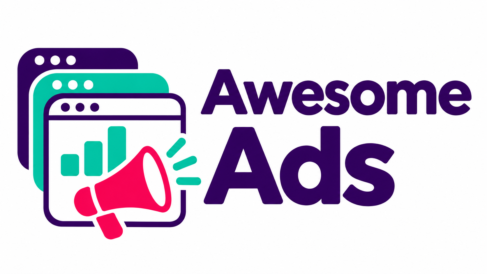

# Awesome Ads

A source-indexed collection of advertising tools, agent skills, ad libraries and platform documentation. Each entry records why it may help, how to use it, its source and its limits.

**545 entries · 123 repositories including 9 Awesome lists · 369 skills · 18 advertising platforms.**

[Browse offline](index.html) · [All resources](ALL-RESOURCES.md) · [Awesome lists](AWESOME-REPOS.md) · [Skills](SKILLS.md) · [Platforms](PLATFORMS.md) · [Research](RESEARCH.md) · [YouTube sample](YOUTUBE.md) · [JSON](registry.json) · [CSV](registry.csv) · [Deutsch](README.de.md)

## Start here

Download or clone the repository and open `index.html` in your browser. Filter by platform and resource type, or search for the problem you need to solve. Press `/` to focus search and Escape to clear it. Markdown and CSV remain usable without JavaScript.

The catalog includes **366 pinned skill files** with SHA256 checksums and upstream license notices. Three other skills remain source links because a suitable redistribution license was not confirmed. Skill files are reference material. They do not install tools or grant permission to change an advertising account.

## Choose a resource for a specific question

| Question | Start with |
|---|---|
| Are conversions trustworthy? | Measurement, tracking and attribution skills; reconcile platform reports with CRM or store outcomes. |
| Where does the account lose qualified demand? | A platform-specific audit using your own reports and business targets. |
| What are competitors showing? | Official ad libraries and dated creative evidence; confirm shared auctions from your own platform report. |
| Which creative or landing-page change should be tested? | Creative, message-match and conversion-review skills with one explicit hypothesis. |
| Can more budget produce profitable business? | Mature conversion data, contribution margin and a controlled experiment. |

Google Ads, YouTube, Meta, Microsoft Advertising, TikTok, LinkedIn, Amazon Ads/DSP, Apple Ads, Pinterest, Reddit, Snapchat, X, Spotify, DV360, The Trade Desk, Telegram, Yandex Direct and VK Ads are represented. Publisher/AdTech and cross-channel methods are separate categories. [See the coverage and gaps](PLATFORMS.md).

## Other Awesome lists

- [Awesome AI Ads](https://github.com/hermoso-ai/awesome-ai-ads) connects ad libraries, agent interfaces and creative resources.
- [Awesome Advertising](https://github.com/cenoura/awesome-ads) focuses on AdTech and programmatic concepts.
- [Awesome Marketing Science](https://github.com/shakostats/Awesome-Marketing-Science) covers measurement methods, including incrementality and marketing-mix models.
- [Awesome Ads by TMHSDigital](https://github.com/TMHSDigital/Awesome-Ads) provides channel playbooks.

[All nine lists, with their intended use and limits](AWESOME-REPOS.md).

## Evidence and scope

Snapshot: **12 November 2026**. Repository metadata was refreshed for all 123 selected repositories. The earlier 100 skill pins are retained; 269 additional skills were indexed at the source/file level. A new index entry is not a full technical or account audit. `commit` identifies the content pin; `latestCommit` records the observed upstream head.

Research used GHMax, Superweb Mega, Gitstars, Metacode, the GitHub API and YouTube searches. The 18-video set combines an earlier sample with 12 new metadata results after deduplication. New results were not transcribed, and view counts do not measure trend velocity. [Method and provenance](RESEARCH.md).

This public repository has no live advertising-account adapters. The separate account assistant is private. Customer data, credentials and analysis snapshots are excluded. Stars, long-running ads and video views do not establish advertising profitability.

## Verify and contribute

With Bun installed, run `bun run verify` to check the registry, local skill hashes, image and repository boundary. No package installation is required. See [CONTRIBUTING.md](CONTRIBUTING.md) for inclusion criteria and [NOTICE.md](NOTICE.md) for third-party attribution. Upstream licenses remain in force; this catalog does not replace them.
